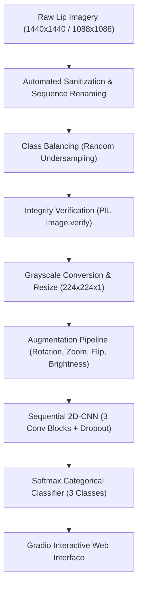

# 👄 Lip Texture Condition Detector

[](https://www.python.org/)
[](https://tensorflow.org/)
[](https://gradio.app/)
[](LICENSE)
[](https://colab.research.google.com/drive/1ulpTz2MeuA1QWiuhwIbcip9z5uMl5xqc)

An end-to-end computer vision and deep learning pipeline designed to assess and classify **human lip health conditions** based on microscopic and visual surface texture patterns using a custom **2D Convolutional Neural Network (CNN)** paired with a real-time **Gradio** web interface.

---

## 📌 Overview & Rationale

Assessing lip health through photographic examination is frequently impeded by confounding demographic factors—such as varying skin pigmentation, lighting variance, cosmetic applications (lip balm/lipstick), and ethnicity.

To eliminate pigment-induced bias and force the model to capture geometric morphology and micro-topography, this pipeline converts inputs to **single-channel grayscale tensors ($224 \times 224 \times 1$)**, isolating:
- **Keratin desquamation** (flaking and roughness).
- **Surface fissure depth** (cracking and dehydration lines).
- **Epithelial continuity** (smoothness vs. ulceration/lesions).

The model evaluates input images across three diagnostic states:
* `sehat` (Healthy): Smooth mucosal barrier, continuous hydration, absence of deep fissures.
* `kurang_sehat` (Sub-healthy): Mild to moderate superficial dehydration, chapped flaking.
* `tidak_sehat` (Unhealthy): Severe fissures, angular/vermilion border inflammation, or active lesions.

---

## 🏗️ Architecture & Pipeline



---

## 📊 Dataset Distribution & Harmonization

To mitigate class imbalance from field-collected samples, the training and evaluation splits were normalized via randomized undersampling:

| Split | `sehat` | `kurang_sehat` | `tidak_sehat` | Total Images |
| :--- | :---: | :---: | :---: | :---: |
| **Train** | 230 | 230 | 230 | **690** |
| **Validation** | 100 | 100 | 100 | **300** |
| **Test** | 100 | 100 | 100 | **300** |
| **Total** | 430 | 430 | 430 | **1,290** |

---

## 🧠 Neural Network Architecture

The network employs a hierarchical feature extractor operating on single-channel texture maps:

| Layer | Kernel / Config | Output Shape | Parameters | Feature Extracted |
| :--- | :--- | :--- | :--- | :--- |
| **Input** | `(224, 224, 1)` | `(None, 224, 224, 1)` | 0 | Normalized texture map |
| **Conv2D Block 1** | 32 filters, $3 \times 3$, ReLU + MaxPool $(2, 2)$ | `(None, 112, 112, 32)` | 320 | Micro-edges, high-frequency gradient transitions |
| **Conv2D Block 2** | 64 filters, $3 \times 3$, ReLU + MaxPool $(2, 2)$ | `(None, 56, 56, 64)` | 18,496 | Keratin peeling contours, crack junctions |
| **Conv2D Block 3** | 128 filters, $3 \times 3$, ReLU + MaxPool $(2, 2)$ | `(None, 28, 28, 128)` | 73,856 | Global fissure morphology & lip border integrity |
| **Flatten / GAP** | Vectorization | `(None, 100352)` | 0 | Flattened spatial feature maps |
| **Dense** | 128 units, ReLU | `(None, 128)` | 12,845,184 | High-dimensional texture embeddings |
| **Dropout** | Rate = 0.5 | `(None, 128)` | 0 | Regularization against co-adaptation |
| **Dense (Softmax)** | 3 units | `(None, 3)` | 387 | Categorical probability distribution |

---

## 📁 Repository Structure

```text
lip-texture-condition-detector/
├── .gitignore
├── requirements.txt
├── README.md
├── app.py                      # Gradio web interface application
├── notebooks/
│   └── lip_texture_condition_detection.ipynb # Original Colab research notebook
├── src/
│   ├── __init__.py
│   ├── data_preprocessing.py   # Sanitization, balancing, cleaning & generators
│   ├── model.py                # 2D-CNN sequential model definitions
│   ├── train.py                # Model training, checkpointing & early stopping
│   └── evaluate.py             # Metrics, confusion matrix, and reporting
└── data/
    └── README.md               # Dataset directory and layout instructions
```

---

## ⚡ Quickstart & Usage

### 1. Installation
Clone the repository and install dependencies in an isolated virtual environment:

```bash
git clone https://github.com/zeyniaa/lip-texture-condition-detector.git
cd lip-texture-condition-detector

# Create and activate virtual environment
python -m venv .venv
source .venv/bin/activate  # On Windows: .venv\Scripts\activate

# Install dependencies
pip install -r requirements.txt
```

### 2. Launch the Gradio Web App
Run the interactive interface locally:

```bash
python app.py
```
Open `http://127.0.0.1:7860` in your browser, upload an image of a lip (RGB or grayscale), and view the real-time classification probability breakdown.

### 3. Model Training
To train the model on your dataset:

```bash
python -m src.train --data-dir data/processed --epochs 20 --batch-size 32 --lr 0.001
```

---

## 🔬 Key Engineering Insights & Future Roadmap

1. **Parameter Efficiency**: Direct flattening of $28 \times 28 \times 128$ feature maps generates $>12$ million parameters in the dense head. Switching to **Global Average Pooling 2D (`--use-gap`)** collapses spatial dimensions directly to 128 channels, dropping parameter size by **>98%** and reducing overfitting on smaller datasets.
2. **Automated Landmark Extraction**: Integrating **MediaPipe Face Mesh** to dynamically localize lip bounding boxes before classification, removing manual cropping steps.
3. **Transfer Learning**: Benchmarking lightweight backbones (MobileNetV3-Small / EfficientNetB0) fine-tuned specifically on dermatological textures.

---

## 👩‍💻 Author
**Zeiniah** ([@zeyniaa](https://github.com/zeyniaa))  
AI & Machine Learning Engineer
